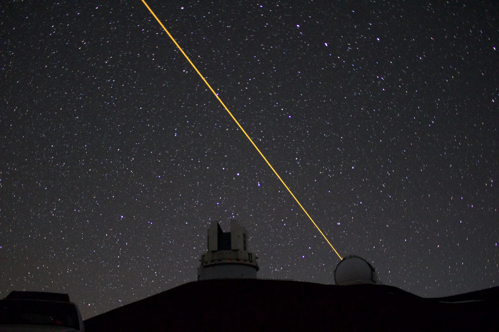
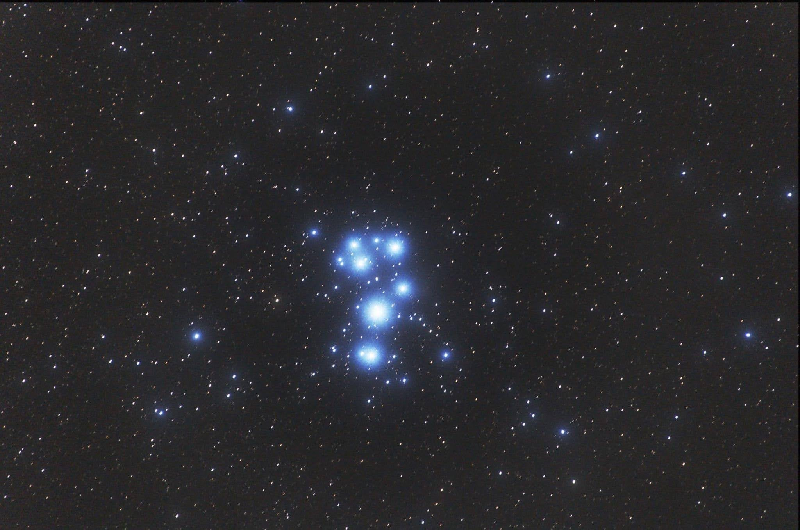
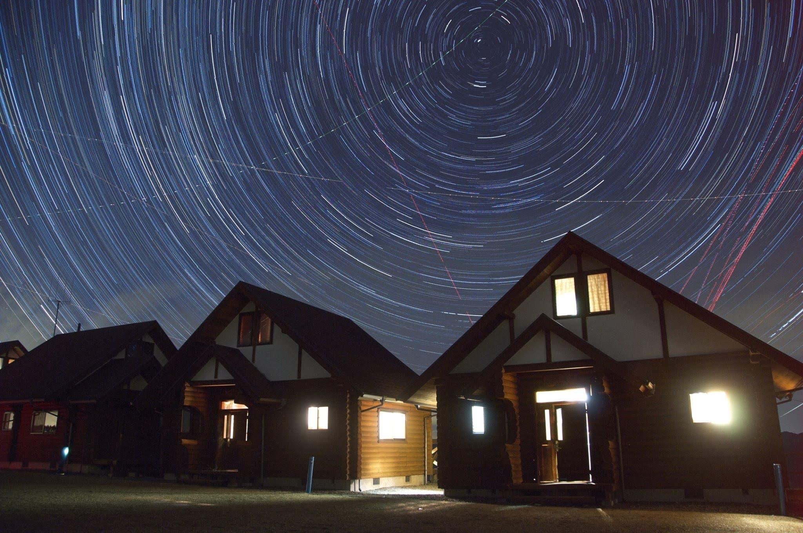

# 🔭 Who am I?

Hi, I'm Tsuyoshi ISHIDA (石田 剛), originally from Japan, working at at Weathernews, Inc as a cloud engineer (infra / backend / frontend).

I also love astronomy and astrophysics.

<table>
  <tr>
    <td></td>
    <td></td>
    <td></td>
  </tr>
</table>

## Carreer Summary

| Period            | Position                                                                                           |
| ----------------- | -------------------------------------------------------------------------------------------------- |
| 2012/04 - 2016/03 | Department of Astronomy, The University of Tokyo                                                   |
| 2016/04 - 2018/03 | Master's Program, Department of Astronomy, Graduate School of Science, The University of Tokyo     |
| 2018/04 - 2021/03 | Doctoral Program, Department of Astronomy, Graduate School of Science, The University of Tokyo[^1] |
| 2021/04 - Present | Cloud Engineer, Weathernews, Inc.                                                                  |

## Dev Skills

### Languages & Frameworks

### Cloud

### Dev Tools

## Featured publication

- [ALMA Observations of the Gravitational Lens SDP.9](https://iopscience.iop.org/article/10.3847/2041-8213/aa7d4a) (K. C. Wong & **T. Ishida** et al, 2017, _The Astrophysical Journal Letters_, 843, L35)
- [First light demonstration of the integrated superconducting spectrometer](https://www.nature.com/articles/s41550-019-0850-8) (A. Endo, K. Karatsu, Y. Tamura, T. Oshima, A. Taniguchi, T. Takekoshi, S. Asayama, T. J. L. C. Bakx, S. Bosma, J. Bueno, K. W. Chin, Y. Fujii, K. Fujita, R. Huiting, S. Ikarashi, **T. Ishida** et al, 2019, _Nature Astronomy_, 3, 989–996)

[^1]: Withdrawn with full completion of coursework
